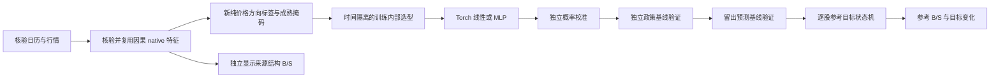

# 参考买卖点与每股目标仓位 v1

公开模型族继续使用 `current`，内部策略为 `reference_position_v1`。分析、扫描与训练沿用原有六个页面。每只股票输出参考 B/S、目标仓位及相对上一参考目标的增减幅度。它们是行情研究输出，不生成模拟订单、成交或资金账本。



## 数据和标签

每个判断日只使用当时已知的行情、流动性与已确认结构。已有 raw/native 来源只有在实际文件、哈希、日历、schema 和人口核验通过后才可复用；旧成交研究的标签、8%/2R 质量头、退出头及权重不属于新目标。

预测周期默认 10 个核验交易日，以判断日之后下一核验日开盘与周期末收盘定义未来价格变化。价格目标是研究标签，不断言该开盘能够成交。缺行情、标签尚未成熟、输入不合格及无法核验的价格异常保持不可用，不能补成下跌类。目标使用对数价格变化，中性边界为 `log1p(max(1%, 判断日已知14日ATR/收盘价))`，上涨超过正边界、下跌低于负边界，其余中性。周期可选10或20交易日，实际边界及行级掩码随计划冻结。

完整历史流动性合格并集参与训练；股票处理批次和训练行批只分配计算资源。当前板块成员不能回填历史标签或特征。预处理只在训练段拟合，模型选型使用训练内部划分，校准、政策基线验证和留出评价分别使用后续隔离区间。标签结束日期必须在所属区间截止前，防止跨段未来目标泄露。

## 模型、设备和验收

58个数值输入由20个MA、22个已确认结构、16个量价特征组成。线性与32→16隐藏层MLP使用自然类别分布；候选只用训练内部经清洗的后20%区间比较。选定后在完整训练段拟合，再在独立校准段选择正温度，不使用类别截距改写排序。训练、批推理和概率校准通过 Torch 执行。`device=auto` 优先选择 CUDA，其次 MPS，最后 CPU；明确指定不可用设备时拒绝，不能静默回退。文件读取、已确认 CZSC 结构、精确价格比较及必要的状态协调保留 CPU。报告记录实际设备，不能由设备可用性推断所有阶段都使用 GPU。

验证分成三层：

- 技术验证：人口、文件、目标、时间清洗、schema、有限概率与完整性。
- 预测验证：政策段的LogLoss与Brier均不得劣于训练段冻结的类别先验；这项门槛用于参考仓位可用性。独立留出测试另外报告LogLoss、Brier、macro-F1、准确率、ECE、类别覆盖及混淆矩阵，不能用测试结果反选模型或政策。
- 独立前瞻资格：实际冻结完成之后的独立证据；历史开发验证和训练完成不授予该资格。

预测结果弱于基线时保留事实，不降低门槛以伪造通过。所有指标是价格方向与参考轨迹评价；没有模拟成交时，不能将其写成交易收益或实盘收益。

## 每股参考轨迹

仓位映射参数在训练前作为先验冻结，本版本没有搜索或优化仓位政策；政策段只验证方向概率是否优于训练先验基线。

每只股票独立维护参考目标 `target_t`，不将各股比例相加为组合配置。参考变化为：

`change_t = target_t - previous_reference_target`

初始参考从零开始并明确初始化。目标受单股上限与风险预算/止损距离共同限制，结合经校准的方向优势计算，使用仓位台阶与滞回减少来回切换。风险仓位上限先向下对齐仓位档位，再约束参考目标，避免风险上限的微小浮动连续触发很小的 S。参考目标变化为正产生 B，为负产生 S，没有变化时不重复标记买卖点。

有效 WAIT 保留上一参考目标。缺失输入或未取得合格评分时保存最后参考值并标记 stale，不把缺失转换成零概率、下跌或卖出。有效硬风险失效可单独触发减至零。可选手工仓位只输出 `manual_comparison_change_fraction`，不改变参考轨迹或历史信号。

来源结构 B/S 与最终参考仓位变化分别显示。历史研究仅使用对应时间窗口的冻结模型；当前时点研究还需核验实际训练完成时间。新版本不能把事后拟合的生产模型回填成当时已发布信号。

## 入口、运维与产物

网页仍使用 `/api/training/preflight`、`/api/training/jobs` 与原任务生命周期。计划冻结后才能提交；参数改变需重新预检，取消通过任务取消检查传播。旧训练任务与诊断可读，新默认入口不能恢复旧成交模型继续训练。

新参考训练失败时可通过 `/api/training/jobs` 的 `resume_reference_run_id` 在原运行接续。恢复前严格核验原数值源码、来源、完整数据集与已完成模型权重；原数值训练定义和有效产物保持不变。修复编排的恢复适配器独立冻结，记录适配器哈希、原计划与本次调度计划。它不能将旧成交研究的权重或标签恢复为新参考模型。

CLI：

```sh
python -m my_strategy.cli train-reference --device auto --source-native-run-id NATIVE_RUN_ID
```

可用 `--config parameters.json` 提供新训练参数、`--preflight-only` 仅核验计划。主要报告为 `reports/reference_training.json`；来源、计划、权重、验证与时间身份随运行保存。清理必须保护核验来源、日历父链、活跃租约、原始行情和个人关注；仅删除已确认无新依赖的旧派生训练产物，并保留删除凭据。
