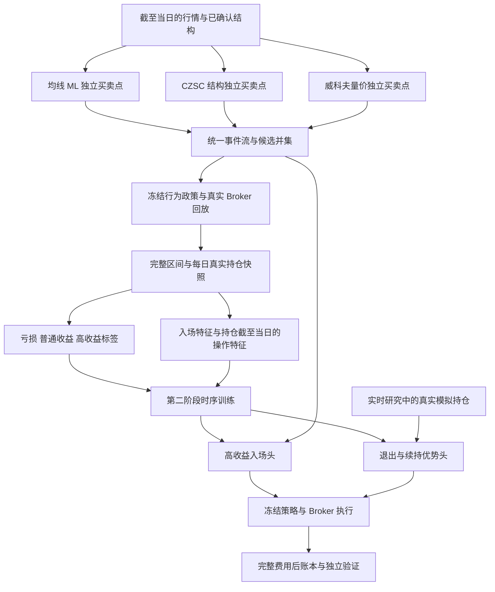

# KHQuant 三类买卖点与高收益区间机器学习实施计划

日期：2026年10月10日。状态：实施计划，尚未实施新策略或训练新模型。

目标是先由均线 ML、CZSC 结构和威科夫量价分别产生可追溯的买卖点，按真实成交规则形成交易区间，再从全部区间中学习高收益操作的特征，训练用于筛选入场、评估续持和选择退出时机的第二阶段模型。实施顺序为信号、区间、特征、模型、账本验证、工作台接入。

本计划采用日线收盘决策、下一核验交易日开盘执行的研究口径。第一版采用现有支持的沪深主板和固定独立股票账户；其他板块、共享现金组合及加减仓分别立新契约。高收益判断是待验证的研发目标，不构成个股投资建议。

## 一 当前链路与目标的差距

截至本次检查，本地原始日线共11,282,344行，覆盖5,572只股票，最新行情日期为2026年10月9日。最新日期不表示所有股票当日都有有效输入；训练和回放须逐股核验覆盖、停牌、缺口与标签成熟情况。

|当前实现|与本次目标的差距|本次处理|
|---|---|---|
|基础 `rule_buy` 由结构买点、均线量价和周线向上共同约束|某一路单独有效的买点会在生成样本前被剔除|先输出三路独立原始点，再形成候选并集|
|均线、结构、量价专家主要预测固定10交易日费用后收益是否为正|正收益、完整策略收益和高收益是不同目标|旧10日模型作为对照，新建实际区间及高收益目标|
|多数威科夫实验在既有 fresh 候选上追加否决，扩池另有 union 实验|还没有统一的三路独立买卖点与区间样本层|增加统一事件契约和来源独立回放|
|已经存在独立真实持仓退出头和实际策略入场头|可复用成交及标签机制，但目标仍不是高收益区间学习|扩展目标与样本层，保留原有目标身份|
|当前 `research-status` 为 `active_release=null`，全池均线模型4个历史窗口均未通过门槛|“production”检查点名称不表示已正式发布或已应用新模型|界面明确候选模型、影子结果和实际执行策略|

因此，新流程应同时解决候选覆盖、目标定义和持仓退出，不能只调整融合权重或概率门槛。

## 二 目标架构



第一层回答“出现了什么买卖证据”。第二层回答“这个候选在指定退出政策下得到高收益的机会及损失风险如何”“当前真实持仓是否值得继续持有”。候选信号、预测分数、订单意图与实际成交分别存储。

第一版第二层的入场能力限定为筛选三路已经产生的候选。若要主动发现三路以外的新买点，另设全部合资格股票交易日的候选扩展实验，重新定义未触发日样本、执行规则和评估预算。退出头则对每日真实持仓评估，可以在没有第一层新卖点的日期提出退出。

## 三 第一阶段独立生成三类买卖点

### 均线 ML 买卖点

沿用现有20项均线趋势输入及其 schema 管理，增加独立的入场和持仓退出目标。均线候选不要求结构买点或威科夫需求事件同时出现。

- 入场端以均线趋势、斜率、价格偏离和回撤状态产生宽候选，再由均线入场头判断。第一版使用费用后完整参考交易收益目标；旧固定10日概率单列为对照。
- 退出端使用均线状态和真实份额、成本、持仓日数、当前浮盈、已发生回撤等，判断下一开盘退出相对冻结续持政策的优势。
- 趋势失效、冻结止损和最长持仓期限提供规则退出。均线买入概率降低不直接转换为卖出概率。
- 候选触发、概率门槛、再次触发条件和去重期限均提前冻结，避免连续多天相同状态被计成多个独立买点。

为避免“入场头依赖尚未训练的退出头”，先以均线规则退出生成第一批训练标签，训练独立退出头；每个前向折随后冻结当时可用的退出政策，再生成该折的入场目标和区间。模型升级另立版本，不能回填同一窗口。

版本顺序固定为规则政策 v0、前向均线买卖头 v1、三路冻结政策区间 v1、第二层高收益与退出头 v1、独立策略回放。下一轮蒸馏或策略优化进入 v2，不能把 v1 自己产生的赢家当成独立有效证据。

### CZSC 结构买卖点

复用原生 Signal、Event、Position 的已确认买卖事件及结构失效规则。完整导出一买、二买、三买及卖点的类型、依赖结构和实际可见时间；哪些类型进入交易候选由冻结配置明确。

- 第一版结构生成器保留原生结构语义，不额外要求均线 ML 或量价模型同意。
- 结构点的价格锚点和确认时间分别记录。只有确认后可见的信息可以产生当日信号。
- 未完成笔、形成中笔和未闭合周月只作图表参考，不充当已确认买卖点。
- 若某个原生事件本身含均线定义，保留该事件的真实语义，并标注依赖；需要“纯结构”对照时使用独立事件子集，不把混合事件改名为纯结构。

### 威科夫量价买卖点

复用因果区间、需求和供应事件。Spring、SOS 表示早期需求证据；Test、LPS 提供确认买入候选；Upthrust、SOW、LPSY 提供风险或卖出证据。事件有效性、区间失效和再次触发规则由版本化状态机定义。

- 买点生成不要求 CZSC 买点同时存在。
- 卖出证据与真实持仓结合后形成退出意图；空仓时仍保留供应事件，但不生成虚构持仓的退出概率。
- 当前32项量价输入可以用于事件质量模型的受控对照，需求规则分数始终与盈利概率区分。
- 第一版不强制增加深度学习。先验证独立规则信号以及量价 ML 是否提供稳定增量。

### 统一事件与候选契约

每个点至少保存以下信息。

|信息组|必需字段|
|---|---|
|身份|`event_id`、`symbol`、`source`、`event_type`、`side`、规则或模型版本|
|时间|`anchor_at`、`observed_at`、`available_at`、`signal_at`、预期执行日|
|证据|结构或区间引用、来源分数、概率对应目标、特征快照哈希|
|资格|输入有效性、候选有效性、失效时间、风险止损、不可用原因|
|谱系|股票池、数据快照、日历、费用、候选和行为政策身份|

同股同日同方向的三路点合成一个候选，保留所有来源及事件引用。跨日相似点按预先冻结的冷却和失效规则处理，不按未来收益去重。同日买卖冲突使用预先冻结的持仓状态优先规则；真实持仓的强制风控退出优先。

候选统一使用 `opportunity_id`，再按 `exit_policy_id` 派生标签分支。来源输入资格分别核验，均线或威科夫不能因没有结构资格而被隐性排除；共同 Broker、行情和交易范围资格另行统一检查。

原始候选层先完整保存三路事件，第二层再学习共振、分歧、先后次序和来源组合。未被选中、被风险拦截和无法成交的候选均留痕。

## 四 从买卖点形成真实操作区间

交易区间定义为实际首次买入成交到实际全部退出成交，不以图上最低点到最高点替代。每个区间保存买点、卖点、来源、实际成交、费用、每日状态和标签成熟时间。

第一版设置四条冻结行为路径：均线独立路径、结构独立路径、威科夫独立路径、三路候选并集参考路径。前三条由各自退出政策运行；并集路径使用统一风险保护和预先固定的退出优先规则。不同路径单独保留政策身份。

为每个当时可决策的空仓候选克隆真实资金与风险状态，在同一 Broker 下尝试入场和续持。这样可以保留参考策略未选择的候选，降低只学习已成交赢家造成的选择偏差。来源独立账户用于解释各方法，并集参考账户用于建立第二层的主要训练状态；同一经济状态的多个克隆不能被当成独立样本。

数据分成两套：逐候选隔离 Broker 的反事实标签区间，以及连续策略账户实际发生的区间与账本。持仓期间再次触发的信号仍记录，但不作为同一真实账户的新成交。若扩大到持仓期间的标准化假设新入场，必须另立账户状态契约，不能与原空仓目标混合。

第二层主入场训练集使用并集参考路径及同一个冻结退出政策。三路独立区间用于信号质量、操作模式和消融研究；如训练跨政策模型，必须显式输入政策身份、统一账户口径并单独评估各政策，不能将不同退出目标无区别拼接。

第一版遵循现有每股固定资金账户口径。样本保存初始现金、可用现金、实际手数、最低佣金影响和冻结风险预算；其他资金规模不能直接复用同一收益概率。若另建共享现金组合，需要重新生成含排序、资金占用和组合约束的状态与标签。

|区间状态|用途|
|---|---|
|完整闭合且亏损|负面操作样本|
|完整闭合且普通收益|对照样本，包括低收益和小幅盈利|
|完整闭合且达到高收益标准|高收益正例|
|拒单或无法完成入场|单独统计执行可行性，不当亏损标签|
|部分成交或退出尚未完成|保留实际状态，收益目标尚未成熟|
|尾部未成熟或期末持仓|删失状态，不强制虚拟平仓、不当负例|
|数据或身份不可信|隔离并保存原因，不静默删除|

可在后续受控实验中研究“均线买入、量价退出”等组合，但必须先固定组合规则和数量。禁止事后枚举所有买卖点组合、挑出最赚钱的一对，再把它当作可实施的训练标签。

## 五 高收益区间的目标定义

高收益标签必须由实际费用后交易结果定义，并绑定退出政策、资金、风险和最长持仓期限。第一版以高收益与风险约束共同满足作为正例。

开发起点暂定为：费用后收益率至少8%，净收益至少达到入场风险金额的2倍，参考政策最长持仓60个核验交易日。8%、2倍和60日均为拟定协议参数，不是已经验证的最优值；正式训练前根据训练段样本量和收益分布检查可行性，冻结一个主定义及至多两个敏感性对照。不得根据测试窗口回调这些数值。

设实际买入总现金支出为 `C_entry`，全部退出净现金收入为 `C_exit`，则完整区间净收益率为 `(C_exit - C_entry) / C_entry`。两者包含实际费用、滑点及经核验公司行动产生的现金或份额变化；分红和股份调整由账本明确处理，不能拿未复权价格差冒充总回报。

风险金额 `risk_cash` 由当时有效的风险止损、实际入场成交价与份额及冻结费用估算定义。止损边界来自信号时可见信息，成交后只按预先冻结的跳空规则核验；风险无效或超过上限则拒绝该交易，不向未来最低价寻找合适止损。

第一版统一采用具备明确止损的风险政策。配置冻结最低风险地板、最大允许风险和跳空越过止损的处理；风险为零、没有止损或风险不可用的旧 fresh 区间不能取得2R标签资格。初始风险金额在入场后冻结，后续抬高止损或部分退出不改变其分母。

主标签采用：

```text
high_return = 完整成熟
              且 net_return >= 8%
              且 net_profit / risk_cash >= 2
```

同时保存净收益连续值、风险倍数、完整持仓时间、最大有利波动、最大不利波动、峰值后回吐与资金占用。最大有利或不利波动来自完整区间的事后结果，只用于标签、分组诊断和操作规律研究，不作为入场特征。每日 OHLC 无法确认同根内价格先后次序时，采用冻结的保守成交规则，不假设理想先后顺序。

部分成交第一版保持单次入场意图；份额、投入和初始风险按实际入场完成的成交聚合，部分退出的净收入累计到完全归零。若引入主动加减仓，重新定义投入、成本和风险契约，不沿用单次入场标签。

最长持仓日触发退出意图后仍必须等待合法实际成交。拒单、停牌或部分退出不能用第60日价格虚拟结算；最终标签按实际全部闭合时间成熟。

对所有完整成熟区间保留“亏损、普通、高收益”三级结果。主入场头预测高收益，连续收益和损失头作为辅助，避免模型把“正收益概率高”误解为“高收益且可接受风险”。

分类边界明确为：净收益不大于零记 `loss`；净收益大于零但未满足全部高收益标准记 `ordinary`；满足全部标准记 `high`。风险身份不可用的区间保留独立原因及收益描述，高收益标签保持不可用，不能强行归入 `high` 或当作负例。

## 六 提取高收益操作特征

从完整区间发现模式，再还原这些模式在实际决策时已经可见的部分。分别建立入场、持仓和退出样本，不将完整赢家路径直接拼进每个买点的输入。

|特征组|入场时可用内容|持仓时新增内容|
|---|---|---|
|均线与趋势|排列、斜率、价格偏离、收敛扩散、此前回撤、量价变化|入场后截至当日的趋势延续或走弱、动量变化|
|结构|已确认笔、中枢、买点类型、距失效边界、闭合高周期方向|新确认结构、支撑失效、结构推进或衰减|
|威科夫量价|区间位置、需求事件、测试深度、缩量回踩、供需证据|新供应事件、放量滞涨、回踩表现、区间破坏|
|三路关系|来源组合、同向或冲突、最近一次事件间隔、前向模型输出|已有信号持续性、新旧事件次序和分歧变化|
|风险与环境|波动率、流动性、已知市场状态、距风险止损、资金与费用比例|实际持仓、含费成本、已持有天数、当前浮盈、截至当日峰值及回吐|
|操作路径|买点之前固定长度的因果历史|仅入场到当前时点的历史前缀，不能跨越当前日|

只有具备历史有效时间的行业、指数和市场环境数据才能进入特征。身份或行情源不足时先省略，不用今天的行业归属回填历史。

操作规律研究可比较“高收益区间常在什么组合出现”“失败区间有哪些相似形态”“高收益途中出现哪些退出预警”。特征筛选、聚类、分位阈值、模板和重要性解释只在训练段建立；在线匹配使用当日历史前缀。每个模板均保留失败对照、来源比例、样本量和跨时期稳定性。

首轮采用固定窗口聚合特征，例如近期斜率变化、事件计数、距最近事件天数和已发生回吐。只有这些特征不足且有独立序列增量证据时，再启动因果序列模型。

## 七 第二阶段模型与决策政策

### 高收益入场头

输入为第一层候选、各路前向输出、当日可见特征和账户状态。主输出为“按指定冻结退出政策形成高收益区间”的概率；辅助输出为预期费用后收益及损失风险。其概率不表示未来最高价的涨幅，也不表示换一个卖出策略后仍有相同目标。

决策先检查输入、账户和风险资格，再按验证段冻结的高收益概率与收益风险门槛筛选候选。第一版保持固定资金和风险预算，不按未经验证的概率放大仓位。

### 退出与续持优势头

输入为真实 Broker 每日持仓状态及截至当日可见特征。对于每个状态克隆两个分支：下一核验开盘开始退出，与按冻结参考政策继续持有。两条分支都完全合法闭合后才形成标签。

主目标为剩余持仓的费用后退出优势，统一按当时持仓价值归一化；若希望惩罚新增下行风险，另立明确风险效用目标并冻结权重，不在同一目标中暗改含义。保存连续优势及 `sell_advantage_positive` 分类标签；很小的优势设置验证段冻结的无动作区间，以降低频繁退出。

比较只针对同一状态的未来剩余净价值，入场后已经获得的利润在两个分支中相同，不重复计为续持优势。最终区间属于高收益，也不能推导出其中每一天都应该继续持有或在最终卖点前一天卖出。

每日对所有真实持仓评分，包括没有新卖点或新买点的日期。风控强制退出、已触发实际止损和原有强制规则优先；模型不能撤销。若预测退出优势明确为正则生成退出意图，否则继续持有。模型缺失时执行已冻结的参考退出政策。

“继续持有”的含义是相对某个固定续持政策的比较，第一版不宣称全局最优卖点。先验证独立退出增量，再将冻结退出头纳入下一版本的入场标签，处理入场目标随退出政策变化的问题。

### 模型选择与冻结预算

先训练逻辑回归或正则线性模型，再比较受限树模型和小型 MLP。第一轮每类至多4组超参数，试验数、种子和失败结果全部保存；候选较多时以预注册的验证账本准则选出一个确认性策略。序列模型另立实验版本与预算。

高收益正例稀少时使用训练段拟合的类别权重并检查概率校准，避免随机跨时间合成样本。概率评估报告 PR 指标、分桶命中率、Brier 或 log loss；这些指标只解释模型，最终优劣仍由完整成交和净值账本判断。

## 八 训练切分与防止未来信息进入决策

两阶段必须一起前向生成。仅把第二阶段切成样本外、第一阶段却使用最终模型回填历史，仍然会泄漏。

每个外层时间窗口执行以下步骤。

1. 在此前训练段拟合第一层必要模型和预处理，清除标签未成熟或跨界样本。
2. 在该训练历史内部做向前切分，生成第一层样本外输出、行为政策与区间；起始阶段没有模型就明确使用规则或保留不可用。
3. 用已经成熟的区间及每日状态形成第二层训练集；用于入场目标的退出政策也必须是当时已经可用的冻结版本。
4. 只在训练集发现操作模板、拟合特征筛选和预处理、训练第二层模型。
5. 将后续验证期分成校准段与政策选择段，或使用严格时序的内层切分；避免校准和阈值无限复用同一小样本。
6. 冻结全部政策后，向前运行外层测试期的连续账户。不能重置持仓以适配模型切换。

所有样本保存 `decision_at`、`label_end`、`label_available_at` 和完整区间身份；退出目标取两分支最晚成熟日，模式挖掘使用完整区间时也必须等区间成熟。

按共同交易日期划分所有股票；同一 episode、同一经济候选及其政策克隆按组管理。清除训练标签跨度与后段重叠的样本，并按提前冻结的依赖规则设置时间隔离。事件型不等距数据不能简单把逐行 `TimeSeriesSplit(gap=...)` 当成完整解决方案，需要日期、episode 和实际标签跨度共同约束。[scikit-learn 时间序列切分说明](https://scikit-learn.org/stable/modules/generated/sklearn.model_selection.TimeSeriesSplit.html)阐明了时序顺序与样本间隔要求。

同一候选的全部政策分支保持同折；同一持仓区间的每日退出样本若跨分割边界，按最晚标签成熟日整体分配或从前段清除，不能分到训练与测试两侧。退出样本按区间平衡权重或冻结的重叠权重训练，同时报告区间数、状态行数和有效日期块，避免长持仓赢家凭大量每日行主导学习。

第一层输出、第二层输出、退出政策、特征和标签分别绑定版本与哈希。历史重建可用日期、实际训练完成时间、冻结时间和真实发布时间分别保存。概率校准使用与模型训练分离的数据，这与[scikit-learn 概率校准说明](https://scikit-learn.org/stable/modules/calibration.html)的原则一致。

新策略执行后会改变持仓分布。下一轮使用新增前向行为产生的状态重新评估覆盖、再训练新版本；不能在同一测试期反复优化直至通过。状态覆盖不足时降低应用范围并保留规则回退，不宣称一次参考政策训练已经覆盖所有新策略状态。

## 九 回测对照与验收门槛

### 实验对照

|实验|回答的问题|
|---|---|
|当前实际规则路径和旧10日模型对照|已有策略具体提供了什么收益与覆盖|
|均线、结构、威科夫各自完整买卖路径|每路独立信号的覆盖和收益特征如何|
|三路并集加冻结参考退出|增加候选本身带来什么变化|
|同一并集加第二层高收益入场头|高收益学习是否优于不筛选及旧正收益过滤|
|同一并集仅加第二层退出头|退出优化的独立增量如何|
|同一并集加冻结入场和退出头|完整策略是否提升收益与风险表现|

主确认性比较为完整二阶段策略对冻结并集参考策略。其余消融用于解释，所有实验预算和主次指标先冻结；不能从很多实验里挑出最好结果，再按单次比较宣称通过。

入场增量对照使用完全相同的原始候选、资金、费用和退出规则。退出增量先在相同参考持仓状态进行两分支诊断，再比较真实连续净值；不能只比较两策略已经平仓的交集。完整策略允许行为分化，但仍使用同一股票池、数据、资金和成本契约。

### 账本指标

必须报告费用后净收益、每日净值、最大回撤、尾部损失、完整往返期望、盈亏比、胜率、高收益占比、高收益覆盖、普通与亏损候选比例、交易数、拒单、未平仓、持仓时长、换手和资金占用。减少交易造成的胜率上升不能单独认定为进步。

费用压力使用冻结政策真实重放1.5倍及2倍费用和滑点，不只从结果中减去一个固定数字。报告新手数、现金、拒单和退出变化；不在压力场景重新选阈值。

### 分层验收

- 工程验收：三路点可独立产生且可追溯；因果时间、模型路由、标签成熟、成交和报告一致；失败、拒单与尾部样本数量守恒。
- 开发研究验收：在当前四个已观察历史窗口和较长连续回放中比较完整账本。保留已有每窗至少50次、合计至少200次完整交易的开发检查；这只是覆盖下限，不是独立统计样本量或正式资格。
- 正式资格：新代码、配置、全部模型和协议实际完成冻结后开始新的独立验证。窗口须预先固定、按实际经核验日历运行；已用于开发的历史窗不能重新包装成独立验证。
- 不放宽现有至少3个完整通过窗口、费用后期望改善、回撤容忍度和配对不确定性要求。新区间目标继续核验160及240交易日依赖块、足够完整块及现有480交易日技术覆盖约束；如需改变，先另立功效和依赖方案，不因季度过短缩短区块以取得通过。
- 配对收益置信下限、最低可检测改善、样本功效及多重比较处理在最终冻结前预注册。无法估计时报告不可用，不用跨股随机抽样制造独立性。
- 补齐历史 ST、退市股票、上市身份、公司行动和可复现总回报账本后，才可以申请正式资格。当前未复权数据可以开展明确边界的工程与开发诊断。

既有双专家未来窗口保持其原协议，不自动转给新架构。工程完成、历史诊断和正式资格是不同里程碑；本计划不承诺在短期实施完成时获得盈利认证。

## 十 代码与存储实施范围

复用 `czsc_analysis`、原生 CZSC、`czsc_research_features` 的因果输入、`czsc_wyckoff_events`、真实持仓快照与候选账户克隆、`BrokerSimulator`、`Ledger.to_frame()`、核验日历、`RunContext` 和当前结果库。新目标不得覆盖旧标签、权重、历史 manifest 或活动别名。

当前主板5%价格保护属于保守研究 guard，不能称为逐股历史真实涨跌停规则。工程回放保留其明确身份；正式资格需要历史 ST 与证券身份驱动的实际价格限制口径。新增模型族的注册和认证检查应扩展同一结果库中的目标与模型包契约，不能伪装成旧固定10日模型通过旧发布接口。

|拟新增模块|责任|
|---|---|
|`czsc_signal_points.py`|三路生成器、统一事件、并集、冲突与有效期|
|`czsc_trade_episodes.py`|来源回放、真实完整区间、每日状态、候选克隆和去重组|
|`czsc_high_return_features.py`|入场与持仓的因果操作特征及有序 schema|
|`czsc_high_return_labels.py`|区间三级标签、收益辅助目标、退出优势及成熟规则|
|`czsc_high_return_models.py`|独立入场和退出头、校准、导出及预测契约|
|`czsc_high_return_research.py`|两阶段前向训练、固定对照和完整账本评估|
|`czsc_high_return_runtime.py`|按日模型路由、实时研究决策与缺失回退|
|`configs/czsc_high_return_research.json`|股票池、风险、区间、阈值、实验预算和未来窗口协议|

这些是拟议责任边界；实施时优先复用现有机制，避免复制 Broker、费用逻辑或模型注册体系。新模型族建议命名为 `czsc_high_return_v1`，同时声明信号、候选、行为政策、入场目标、退出目标与特征版本。

输出写入独立 `artifacts/runs/`，大量事件、区间和状态采用有 schema 的分片文件；当前 `processed/czsc/results.db` 存索引和身份，任务仍走 `metadata/czsc_tasks.db`。个人关注和手动持仓保持独立。每个数据集保存覆盖及状态计数、来源快照、哈希、完整区间、每日状态、模型清单、真实成交和净值文件。

拟增加 CLI 命令：`research-points-build`、`research-episodes-build`、`research-high-return-train`、`research-high-return-backtest`。现有 CLI 中尚无这些命令，需在实现后提供帮助和复现示例。

## 十一 工作台展示与使用流程

结构分析展示三路原始买卖点及各自理由，另显示第二阶段入场判断。图表明确区分信号确认日、订单意图和实际成交。没有真实持仓状态时，不展示伪造的持仓退出概率。

扫描页分别显示候选来源、高收益判断、风险原因和可执行资格；不可用概率保留为空并显示原因。回测页提供第一层各路、并集参考及第二层完整策略的账本对比。持仓页根据用户实际记录的持仓状态显示研究性退出判断，并明确其成本、资金和状态契约是否兼容。

面向用户只保留有用的状态，例如“候选信号”“影子模型”“已验证策略”“输入不足”；代码哈希和详细模型谱系放入详情。不能让“生产模式”或一个概率数值暗示尚未通过的策略已经生效。

## 十二 分阶段执行和交付物

|阶段|主要工作|交付物及通过条件|
|---|---|---|
|P0 协议与数据核验|冻结目标、股票池、资金风险、日历与数据身份；确认实际生产路由；检查高收益定义可行性|协议配置、数据缺口表、基线报告；所有拟定参数有明确身份|
|P1 三路点生成|先完成规则事件、v0 行为和生成器，再接入 P2 形成的前向均线头；统一事件、时间、并集和冲突|规则事件与最终前向事件分开；任一路可在另两路未触发时产生候选|
|P2 真实区间与第一层训练|先构建 v0 bootstrap 区间并训练逐折第一层头；再用冻结前向信号运行四条行为和候选克隆|最终三路区间、每日状态、成熟与删失、L1 OOF 谱系、数量守恒与独立费用复算|
|P3 操作特征研究|高收益与失败对照、历史前缀特征、训练段模式提取、特征稳定性|特征 schema、模式报告、正负样本和跨时期覆盖；未来列无法进入预测器|
|P4 二阶段训练|审核已生成的第一层 OOF 谱系，训练第二层入场与退出独立头、校准、冻结预算|可重载模型包、第二层时序谱系、目标契约及概率诊断|
|P5 完整账本验证|主比较和消融、连续持仓、真实成本压力、失败及未平仓审计|全股票池开发报告；不满足增量时保留参考策略并明确失败原因|
|P6 工作台与影子接入|分析、扫描、回测和持仓统一模型身份及状态|真实输入端到端验收、操作说明和研究结果展示|
|P7 独立前向验证|实际完成冻结、预注册窗口与功效、按真实时间追加结果|成熟独立证据及资格判断；达到门槛后再走现有追加发布流程|

P0 至 P2 是关键路径，应先证明买卖点和交易区间正确，再大规模训练。数据核验、三路生成器和展示原型可以并行；第二层标签必须等待退出政策及区间协议冻结。

P1 与 P2 内部按以下依赖顺序运行：P1a 规则事件及 v0 政策，P2a bootstrap 区间和标签，逐折训练并冻结第一层买卖头，P1b 输出严格前向信号，P2b 生成最终三来源及并集区间。P3 仅使用 P2b 已成熟区间；P4 才训练第二层。两次数据生成有不同身份，不能将 bootstrap 的训练内输出混入最终样本。

工程工作分配为策略与模型、数据与存储、Broker 与标签、工作台、运行与审计五类职责，由协调者统一契约。第一轮按约10至15个工作日安排工程与开发验证，具体取决于数据缺口、样本规模和真实运行耗时；独立验证时间另按已冻结日历、区间成熟和统计功效计算，不包含在该估计中。

首轮先跑小样本验证日期、成交与样本数量，再跑支持范围内的完整股票池。CPU负责因果准备及 Broker 回放，父进程批量执行模型训练和推理；明确要求的 MPS、CUDA 或 CPU 记录真实执行量，不能静默切设备。并发任务使用独立运行与输出根。

## 十三 必须验证的失败场景

实施后重点验证以下有实际意义的场景。

1. 追加未来行情不改变过去的买卖点、特征和模型选择；形成中结构的后续变化不回填过去。
2. 均线、结构或威科夫单独触发时均能进入原始候选；同日多来源只产生一个经济候选，并保留全部证据。
3. 训练或校准标签跨边界、未成熟区间、重复经济状态及未来检查点均被正确拒绝。
4. 高收益字段、未来最大涨幅和最终卖出日期不能进入入场特征；持仓历史最多到当前时点。
5. 拒单、T+1、价格限制、停牌、部分成交和尾部未平仓保持真实状态，不产生虚拟收益；费用与 `Ledger.to_frame()` 可独立复算。
6. 没有新事件的真实持仓日仍能获得兼容退出评分；空仓时没有虚构退出概率；模型不能覆盖强制止损。
7. 入场和退出政策变化会触发目标契约变化；旧固定10日权重不能冒充高收益区间模型。
8. 跨模型检查点保持现金和持仓连续，缺模型时正确执行冻结回退政策；网页、CLI和批量任务显示相同身份。
9. 数据失败账户及排除标的进入覆盖报告，基线与新策略使用相同冻结资金口径，样本和结果数量可对账。

验收优先使用当前 CZSC 专项测试和真实输入审计。技能自带旧工作区检查器仍引用两个已退役的 processed/model-registry 路径；其本次非零结果不能直接解释为当前结果库损坏，也不能以恢复旧目录解决。应将现行只读验收入口对齐当前架构后再纳入新流水线。

## 十四 当前实施边界与源码依据

本次只追加计划与审计记录，没有调整交易规则、训练模型、修改费用、发布新策略或覆盖既有独立窗口。

主要源码和协议依据如下，相对路径均以应用根 `app/` 为起点。

- `my_strategy/services/czsc_research_features.py`：现行复合规则买点和20项均线输入。
- `my_strategy/services/czsc_research_decisions.py`：模型过滤规则入场及原生 Position 路径。
- `my_strategy/services/czsc_wyckoff_research.py`：固定候选过滤、union 扩池、前向行为和实际策略头。
- `my_strategy/services/czsc_wyckoff_exit.py`：真实持仓分支退出和候选克隆入场目标。
- `my_strategy/services/czsc_research_strategy_labels.py`：完整成交收益与成熟时间。
- `my_strategy/services/czsc_backtest.py`：实际执行、账本和拒单。
- `my_strategy/storage/czsc_model_releases.py`：独立认证和追加发布约束。
- `AGENTS.md` 及2026年10月9日均线、双专家、威科夫 ADR：现行目标、时序、数据和影子研究约束。

第一阶段完成的标志是三路可独立解释的买卖点和正确的全量区间样本。第二阶段完成的标志是高收益目标及退出优势在完整费用后样本外账本中提供稳定增量；如果没有增量，应如实保留研究结论并停止晋升。
