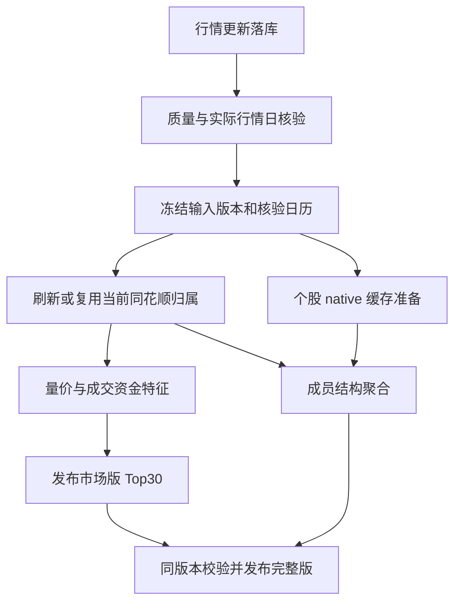

# 主工作台板块排名与每日特征同步计划

将同花顺板块功能合并到 `http://127.0.0.1:8124/` 的“全市场扫描”，提供行业、概念的活跃与成交资金 Top30，以及板块结构详情。计算主要读取已有 `khquant_raw.db` 和 `native_structure.db`，`basic_kb.db` 仅提供成员映射，将聚合后的指标迁入 `stock_fluent/basic_fluent.db`；“更新行情”统一启动板块派生与个股 native 缓存更新。

本轮交付计划，尚未修改功能。实施范围只处理当前成员和最新核验行情。计算当前滚动指标及结构所需的过去价格窗口可以读取，不补历史成员变化，不生成历史排行榜，不启动模型训练。

## 1 当前基础与接入边界

2026-10-14 已有 710 个同花顺板块：行业 320、概念 390，80,725 条 A 股成员关联，覆盖 5,581 只股票。现有 684 个板块满足 5 成员和 80% 覆盖门槛，有完整 12 项指标；26 个小板块保留缺失。成员观测日为 10 月 14 日，最新本地行情为 10 月 12 日。当前 native 缓存有 3,194 个条目，不等于全部板块成员均有最新 native 数据。

主工作台仍为六页。代码已包含板块路由，但正在运行的 8124 服务尚未加载它，`/api/boards/status` 返回 404；8125 为当前过渡服务。现日更脚本完成行情、质量与 CSRC 元数据阶段，没有板块/native 同步。板块任务仍使用进程内任务字典，派生查询会读取整包 JSON，需要迁移为持久任务和按行查询。

本地没有真实主力买卖或净流入。[Fuyao 资金文档](https://fuyao.aicubes.cn/docs/api-reference/capital-flow/)明确其资金能力暂未开放外部接入。因此第一版资金面展示成交额、市场成交占比与放量强度，真实主力净流入保持不可用，不将成交额或涨跌乘成交额命名为净流入。

计算来源固定为：`khquant_raw.db` 提供股票 OHLCV、成交额和涨跌；`native_structure.db` 提供已有 CZSC 与威科夫证据；`basic_kb.db` 将股票映射到板块；`basic_fluent.db` 保存按板块聚合的结果。首版不新增同花顺指数 K 线采集，不用合成指数代替成员结构。现有适配器将 API `turnover` 成交额存为本地 `amount`；本地 `turnover` 全为零，第一版不据此展示真实换手率。

## 2 主站内的操作与展示

保留六个主导航，在“全市场扫描”增加“个股 / 板块”切换。板块内分“行业 / 概念”，分别提供“活跃 Top30”和“成交资金 Top30”，每类、每榜最多 30 条，不把行业和概念混成一个榜。

进入面板先读取已发布缓存。点击“计算当前板块”提交异步任务；同输入已有结果则复用，正在计算则返回同一任务。提供“更新当前归属”和“重算当前”操作。浏览、翻页和点详情保持只读，不重复发起全量采集或 native 回放。

| 展示区域 | 内容 |
| --- | --- |
| 状态条 | 行情日、成员观测日、指标生成时间、行情/板块/native 各自完成状态、过期或失败原因 |
| Top30 表 | 排名、板块名、活跃分、成交额、市场成交占比、20 日放量强度、1/5/20 日收益、上涨成员比例、结构状态、有效成员/覆盖 |
| 板块详情侧栏 | 当前成员、量价指标、成员 CZSC/威科夫广度及对应确认依据；可跳转现有股票分析 |
| 数据与任务 | 同一日更任务的阶段进度、命中/重建/失败数、三库日期、继续失败阶段的入口 |

已有数据可先显示并标明日期。最新行情与旧 native 不混装成一份“最新结果”；结构正在计算时该列明确显示处理中。所有行业指数保留来源代码；层级未核验时不擅定一级行业。三胎概念继续显示来源 213 人、A 股投影 212 人和 NQ 排除项。

整合验收后主界面不再依赖独立 HTML、iframe 或 8125 服务；旧 `/boards` 入口可引导至主工作台板块面板。

## 3 指标与排名口径

复用已有 12 项板块指标和 22 列个股关联指标，默认门槛继续为至少 5 个有效成员、指标覆盖至少 80%。缺失保持空值，不以零补齐或强凑 30 个。

**活跃分**拟冻结为：`100 × [P(20日相对成交额) + P(|1日板块收益|)] / 2`。`P` 在同类型合格板块内取百分位，并列取平均秩，归一到 0—1；只有一个合格板块时取 0.5。最后同分按完整板块代码排序。它度量量价活跃程度，涨跌方向、上涨比例、MA20 与创新高比例单独展示，下跌活跃不写成上涨强势。公式、阈值和版本入库，不拟合模型权重。

**成交资金榜**默认按当日合格 A 股成员成交额降序，再按代码稳定排序，附市场占比与 20 日相对成交额，可切换按放量强度排序。市场分母按唯一合格 A 股求和。每个板块内成员去重；概念和行业之间存在重叠，榜单金额不能相加当成市场总量。

未来存在可接入且核验通过的真实资金源时，另开“真实净流入”榜，记录提供方的大单分类、买卖金额、净额、单位、时点和覆盖。不同资金口径分别排名；成交额榜与净流入榜不混排。缺该来源不会阻塞当前成交资金榜，也不计作行情更新失败。

**板块结构定义为成员原生证据的聚合**：读取 `native_structure.db` 中与实际行情日、原始输入、日历、结构参数和代码身份匹配的个股证据，按 `basic_kb.db` 当前成员去重后汇总已确认的笔/中枢方向、结构突破与失效，以及 Spring、SOS、SOW、UTAD 等已有威科夫事件状态。

- 保存上行/下行结构成员比例、中枢突破/失效比例、确认量价事件成员比例和近期确认事件活跃度；具体事件列与现有 native 契约绑定，不另造确认规则。
- 每个指标保留有效 native 数、全部 A 股成员数、准备人口范围、覆盖率及缓存引用。缺缓存、数据日不同、输入内容或契约不匹配时记为未覆盖，不能计为“无事件”。默认门槛继续为 5 人/80%，不为凑榜降低。
- native 首次读取时验证 Parquet/gzip 双物理 SHA 与生成身份，提取目标行情日精确匹配且可用时点合格的 evaluation；structure 与 wyckoff 各自保留 eligible、方向、评分、事件 ID 和不合格原因，按 ID 关联原始事件。不能将 warmup 或其他不合格状态当有效零值。同一股票属于多个板块只提取一次。
- 索引摘要绑定 native 缓存键、双输出 SHA、提取 schema 和行 SHA，按 generation/股票/行情日存入派生库。身份核验采用 native 所记录的同一完整原始依赖窗口，不能拿 41 日量价窗口的内容 SHA 替代长历史身份。以后按行读摘要，避免每次点击解压全部历史证据。
- 这些是成员结构广度，不将成员的笔/中枢拼接成板块指数本身的笔/中枢。真实 `.TI` 指数结构接入属于范围外的后续扩展。

结构不作为首版活跃榜的隐含加分项，避免 native 未完成影响已可用的量价排名。当前结果统一为 `current_reference`，不进入现有历史入场/退出模型。

## 4 数据库职责与读取方式

建议派生库使用 `PROCESSED_DATA_ROOT / "stock_fluent" / "basic_fluent.db"`，通过新的 `BASIC_FLUENT_DB_PATH` 和可配置环境路径解析，不写死宿主路径。

| 数据库 | 职责 |
| --- | --- |
| `data/raw/khquant_raw.db` | 股票原始行情、质量及更新事实，继续作为价格来源 |
| `data/raw/stock_basic/basic_kb.db` | 股票基本资料、同花顺目录、完整成员快照、来源证明、归属更新记录 |
| `data/processed/stock_fluent/basic_fluent.db` | 板块/股票派生量价、资金、结构摘要、排名、发布版本与同步记录 |
| `data/processed/czsc/native_structure.db` | 现有个股 CZSC/威科夫缓存及完整生成身份；不复制模型、标签或权重 |

派生库拟包含以下表，名称在实现时与最终 schema 一起冻结：

| 表 | 粒度与主要用途 |
| --- | --- |
| `sync_runs` | 父更新批次、冻结输入、阶段状态、子 run、失败、重试及进程租约 |
| `feature_generations` | 基础版本、行情日、成员/日历/源码/政策/资金来源身份，市场版和完整版发布状态 |
| `board_daily_features` | generation × board_id，12 项数值、资金字段、活跃分与覆盖 |
| `stock_daily_features` | generation × symbol，关联指标及对应 native 缓存引用 |
| `native_stock_summaries` | generation × symbol × price_date，目标日结构/威科夫资格、状态、事件引用、双输出 SHA 及摘要行 SHA |
| `board_structure_features` | generation × board_id × structure_basis，成员结构广度及原生证据引用 |
| `board_rankings` | generation × kind × ranking_type × rank，持久 Top30 与确定排序 |
| `feature_input_refs` | 股票价格内容/版本、native 缓存键与物理 SHA、成员快照、日历和参数身份；不复制整份股票原始行情 |

板块、股票和排名建立按版本、类型、实体、日期的索引。展示列采用可查询数值列，JSON 只作每行补充元数据、原始证明和审计导出；不再为每次查询解析整个市场的约 28 MB JSON。native 全量证据保留在所属缓存，派生库保存引用和必要摘要。

现 `basic_kb.db` 的已有派生缓存先只读导入新库，逐项验证数值、缺失、时点与代码身份。迁移完成后新派生结果只写 `basic_fluent.db`，归属事实继续写知识库。旧不可变缓存保留迁移凭据，不删除仍被引用的数据。

## 5 每日更新链与一致发布

网页“更新行情”和 CLI 日更使用同一编排器。接入点为 `update_daily_data.py::main()` 的质量/现有元数据阶段之后，由 `TaskManager._update()` 接收全部阶段事件；不在每个下载线程里启动板块或 native 运算。

1. 以实际取得并通过质量检查的交易日为目标，不直接使用用户请求截止日。本地缓存成功、空返回或无新交易日须区分；同身份重复执行明确标为复用。
2. 冻结原始内容、修订版本、股票准备人口和已核验日历；逐股比对原始价格依赖与 native 身份，不能仅按代码挑“最后一条缓存”。更新入口维护可查询的原始版本水位，修订旧价也使依赖失效；生成时仍验证实际依赖内容 SHA。
3. 同一天已核验的成员快照可复用。需刷新时遵守串行限流、请求预算、退避和断点恢复；只采当前归属，不补过去变化。旧成员版本不能冒充今天已更新。
4. 先生成量价/成交资金市场版，在原始价格和归属输入核验后发布 Top30。完整结构尚未就绪时，界面显示对应阶段和缺失状态。
5. 后台准备或复用个股 native，再聚合成员结构。股票缓存沿用现有合格准备人口和冻结结构配置，分别报告准备人口及对板块成员的实际覆盖，不自动扩大现有模型人口。
6. 每个库独立事务、追加记录；用同一 `sync_id`、基础输入版本和输出哈希关联。在派生库一次事务切换发布指针，仅读已完成且引用已验证的组件。三个 WAL 库的提交不当成跨库原子事务。
7. 市场版可先发布，完整版只能在所要求的结构阶段已完成并验证后发布。真实资金源不可用或个别对象失败须在组件状态及覆盖中明确表达。全部必需阶段完成前，整体任务不得显示“全部同步成功”。

新增持久任务种类和跨 CLI/网页租约：同输入去重；租约包含 PID、进程创建时间和心跳。崩溃或重启后，核对冻结输入、输出 SHA、检查点和租约，再继续未完成阶段。取消不回滚已成功行情；保存各阶段实际结果和可恢复检查点。失败保留上次已发布版本，并明确其日期。

缓存指纹覆盖行情内容与修订、成员快照、日历、可用资金来源、结构参数、schema、排名政策和生成码。轻量查询水位判别过期，实际计算以冻结内容 SHA 为准。旧日结构不与新日市场版静默拼接，同一天无依赖变化不再数值重算。

## 6 native 更新成本与增量路线

当前缓存绑定整份原始内容和整个日历身份；新增交易日一般会失去旧键命中，未命中后会完整回放历史。目前不具备“只补新增一天”的能力。首版日更调用现有 `freeze_raw_source()` / `prepare_native_source()` 或 `--prepare-source-only`，仅准备来源和缓存，`training_started=false`；使用有界 CPU 队列、逐股检查点和单协调器写入。

native 是后台阶段，展示其实际处理人口、命中、重建、失败和当前阶段 ETA。存在训练时设置独立资源预算，避免与训练争用全部 CPU；不会调整已运行任务的参数、环境或来源。同输入的旧成功缓存保留，新版本未完成不会覆盖它。新增日的全量耗时须实测，不能用板块量价约 18 秒的耗时替代 native 预估。

真正日更增量列为后续优化阶段：持久化完整 CZSC、日/周/月聚合、笔/中枢确认依赖、Wyckoff 待确认/失效状态和原始前缀身份。仅在前缀、日历、参数、引擎与 schema 完全一致时追加新 bar；历史修订或状态缺失回退完整重建。与完整回放核对数值、确认时点及事件输出，覆盖新股、停牌、周/月闭合、修订和崩溃恢复。通过等价验收前保留首版安全回放路径。

## 7 实施顺序与验收

| 阶段 | 交付 | 验收 |
| --- | --- | --- |
| 1 存储与迁移 | 新派生库、版本指针、按行查询及旧缓存导入 | 710 板块/5,581 股票现有结果逐项一致；684 完整/26 缺失保持；无原行情改写 |
| 2 主工作台与排名 | 扫描页内行业/概念双榜、详情、显式计算及持久任务 | 各榜确定 Top30；缺失不入榜；热读不重算；主界面无独立页或 8125 依赖 |
| 3 结构来源 | 个股 native 引用与广度，最新摘要索引和成员事件广度 | 先验证少量板块独立聚合，再扩全量；相同原生输入与时点、事件确认和覆盖完整；无缓存时保持未覆盖 |
| 4 每日编排 | 统一日更、分阶段进度、租约、两级发布、失败续跑 | 网页和 CLI 都触发；同身份复用；部分失败/取消/重启可恢复；三个缓存库水位与发布引用一致 |
| 5 安全切换 | 8124 注册新接口及主页面，验收后退役 8125 过渡入口 | 活跃训练生成码、参数、冻结来源和权重不变；浏览器功能验收；主站接口和重复计算按钮实际通过 |
| 6 增量优化 | native 状态续算与回退 | 与完整回放等价后才启用，单独报告冷/热/新增日实测 |

现 8124 进程拥有训练生命周期，`TaskManager.close()` 会取消任务。开发与测试在隔离工作树进行，主站需要重新加载路由时安排在当前训练结束后；若提前切换，必须先完成并验收工作进程生命周期解耦，不能直接重启正在拥有训练的服务。本计划不执行该切换。

验收至少覆盖行情未前移、旧价修订、归属变化、NQ 投影、重叠概念、低成员/低覆盖、无真实资金源、native 缓存缺失/时点错配、429、任务重复、两个进程同时更新、各阶段崩溃与取消，以及 native 缓存身份改变。排名是当前市场观察，不修改入场/退出标签、费用、8% 且 2R、模型选择或正式资格。
